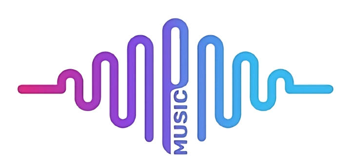

<div align="center">



# BeatzPro

**Un reproductor de música multiplataforma, sin publicidad y sin cuenta, hecho con Flutter.**

[](https://flutter.dev)
[](https://dart.dev)
[](#plataformas)
[](pubspec.yaml)
[](#licencia-y-créditos)

</div>

---

## Descripción

BeatzPro reproduce música de YouTube Music con caché, descargas, radio, listas de reproducción, letras sincronizadas, ecualizador y temporizador de apagado. No pide iniciar sesión, no muestra publicidad y mantiene tu biblioteca guardada en el propio dispositivo.

Tiene una interfaz propia (diseño «Onda»: la forma de onda del logo es la barra de progreso) y un reproductor adaptado a los cambios recientes de YouTube.

## Características

- Reproducción de canciones y videos de YouTube Music, con **música en segundo plano**.
- **Caché de canciones** mientras se reproducen y soporte para **descargas**.
- **Radio**: al terminar la cola agrega canciones parecidas.
- **Listas de reproducción** propias y marcadores de álbumes y artistas.
- Importación de canciones, listas, álbumes y artistas compartiendo desde YouTube / YouTube Music.
- **Letras** sincronizadas y simples, con la línea actual resaltada.
- **Tema dinámico**: los colores de la app siguen el color de la carátula de la canción que suena.
- Temporizador de apagado, con opción de esperar a que termine la canción.
- Ecualizador, saltar silencios y control de calidad de transmisión.
- Integración con listas de reproducción de **Piped**.
- Soporte multilingüe (español por defecto).

## Vista previa


## Plataformas

| Plataforma | Estado |
| --- | --- |
| Android | Probada en dispositivo |
| iOS | Proyecto configurado |
| Windows | Soportada por el código |
| Linux | Soportada por el código |

## Tecnologías

| Área | Herramienta |
| --- | --- |
| Framework | [Flutter](https://flutter.dev) **3.41.9** (gestionado con [FVM](https://fvm.app), ver [`.fvmrc`](.fvmrc)) |
| Lenguaje | Dart 3.11 |
| Estado y navegación | [GetX](https://pub.dev/packages/get) |
| Audio | `just_audio`, `audio_service`, `just_audio_media_kit` |
| Extracción de YouTube | `youtube_explode_dart` |
| Datos locales | [Hive](https://pub.dev/packages/hive) |
| Color dinámico | `palette_generator` |
| Letras | `flutter_lyric` (letras de [lrclib.net](https://lrclib.net)) |
| Tipografía | Nunito Sans (interfaz) y Acme (letras), vía `google_fonts` |
| Íconos | `flutter_svg` |

## Primeros pasos

### Requisitos

- [FVM](https://fvm.app) o Flutter **3.41.9**.
- Android Studio / Xcode según la plataforma de destino.

### Instalación

```bash
git clone https://github.com/VMichael1999/BeatzPro.git
cd BeatzPro
fvm install          # usa la versión de .fvmrc
fvm flutter pub get
```

### Configuración

Copia el archivo de ejemplo y completa tu clave si la necesitas:

```bash
cp dart_defines.example.json dart_defines.json
```

`dart_defines.json` está en el `.gitignore` y nunca se sube al repositorio.

### Ejecutar

```bash
fvm flutter run --dart-define-from-file=dart_defines.json
```

### Compilar

```bash
fvm flutter build apk --release --dart-define-from-file=dart_defines.json
```

## Estructura del proyecto

```text
lib/
├── models/        Modelos de datos (canciones, álbumes, artistas, listas)
├── services/      Música, parser de YouTube, audio, descargas
├── ui/
│   ├── player/    Reproductor, mini reproductor y su controlador
│   ├── screens/   Inicio, búsqueda, álbum, artista, biblioteca, ajustes
│   ├── utils/     Tema y tokens de diseño
│   └── widgets/   Componentes reutilizables
└── utils/         Utilidades y localización
```

## Licencia y créditos

BeatzPro se distribuye bajo la licencia **GNU GPL v3**. Consulta [LICENSE](LICENSE) y [NOTICE.md](NOTICE.md).

- Las letras provienen de [lrclib.net](https://lrclib.net).
- Las carátulas y el contenido pertenecen a YouTube Music y a sus autores; BeatzPro no los aloja.

> **Uso previsto:** personal y de portafolio, distribuido por GitHub. No está pensado para publicarse en tiendas de aplicaciones ni para uso comercial.

> **Aviso:** BeatzPro no está afiliado a YouTube ni a Google. Úsalo respetando los términos de servicio de las plataformas.
